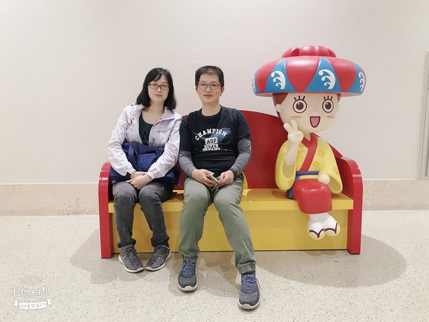

我專注 **AI Agent 與 SAP 整合**，以 20 年以上企業系統經驗，將財務、採購與製造需求轉成可驗證的工具和流程。SAP FI／AM、ABAP 與跨系統整合是我的基礎，MCP、企業 RAG 與自動化是近年的實作方向。

## 近期成果

- **2026 SAP RFC 網關整合**：完成 SAP 連線、函數探索及資料查詢驗證，處理舊版 RFC_READ_TABLE 相容性。
- **SAP MCP 請購單 POC**：以 FastMCP 串接既有 FastAPI／PyRFC，結合主檔與歷史資料查詢，探索自然語言操作 SAP 的流程。
- **企業知識與流程自動化**：實作本地 RAG 文件問答，以及 SAP／MES、UiPath、Python、OCR 整合；使用單位曾回報 A、B 廠生產排程各每日節省 125 分鐘。

## 經驗主軸

2021 年起在 KINIK 工作，涵蓋 SAP／HANA／FI、跨系統整合與自動化。此前參與 SAP 海外子公司 roll-out、醫療物料管理及長期 FI／AM 支援，累積供應商平台、費用查詢、電子發票與資產管理經驗。

我重視需求拆分、資料與欄位的正確性，以及流程異常的可追查性。讓 Agent 理解需求、讓工具可靠執行，是我持續投入的方向。

[完整履歷](/resume)｜[最新 SAP Agent 成果](/notes/sap-agent-integration)｜[2021–2025 實作摘要](/notes/automation-journey-2021-2025)

[Email](mailto:fordsupr@gmail.com)｜[GitHub](https://github.com/fordsupr)｜[LinkedIn](https://www.linkedin.com/in/jason-li-i3bigdata)
